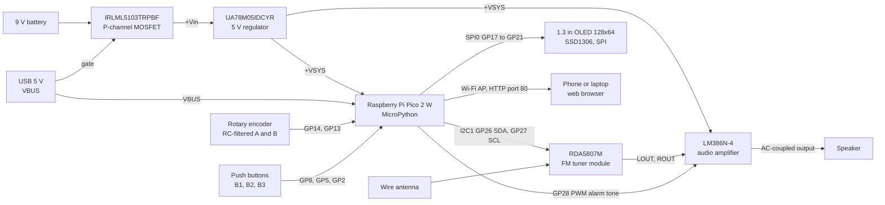

# Turtle FM Clock Radio

An animal-themed FM clock radio with alarm, built on a Raspberry Pi Pico 2 W in MicroPython with a custom two-layer KiCad PCB, a browser control panel and a 3D-printed turtle enclosure, developed for ECE 299 at the University of Victoria.

[](LICENSE)


**Authors:** Oscar Bazylewich, Ethan Packer

<p align="center">
  
  <br/>
  <em>The finished clock radio showing its home screen: current time, alarm time, volume and tuned station.</em>
</p>

## Overview

This project combines digital timekeeping, FM radio tuning and wireless connectivity in one compact embedded system, driven entirely by a single Raspberry Pi Pico 2 W programmed in MicroPython. It has two synchronized control interfaces: a physical rotary encoder and three push buttons, and a web page served by the Pico over its own Wi-Fi access point. Both interfaces call the same state-handling functions, so they always agree on what each input does.

### Features

- **Clock and alarm:** time set from the knob or synced from a phone's clock over Wi-Fi, 12 h / 24 h display toggle, alarm with adjustable time, on/off toggle, volume (0–15) and tone (200–2000 Hz); any button silences it.
- **FM radio:** RDA5807M tuner over I2C, tuned in 0.1 MHz steps from 87.0 to 108.0 MHz, with 16 volume levels and mute.
- **Dual UI:** rotary encoder and buttons on the device, plus a mobile-friendly web page with the same buttons, virtual knob controls and a field for entering exact values.
- **Shared OLED display:** one 128×64 SPI OLED shared between the clock, alarm, volume and radio screens through a centralized menu state machine, with an on-screen legend for the three buttons.
- **Alarm audio:** a PWM square wave on GP28 is injected into the LM386 amplifier; the radio is muted while the alarm sounds and restored afterwards.
- **Dual power:** runs from USB or a 9 V battery through a MOSFET-switched 5 V linear regulator.

## Table of contents

- [Overview](#overview)
- [Hardware](#hardware)
- [Firmware](#firmware)
- [Using the clock](#using-the-clock)
- [Getting started](#getting-started)
- [Repository structure](#repository-structure)
- [Testing](#testing)
- [Credits](#credits)
- [License](#license)

## Hardware

### System block diagram



*GPIO numbers follow [`firmware/main.py`](firmware/main.py) and the schematic below. The Pico's 3V3 output supplies the radio module, the OLED and all pull-up resistors.*

### Circuit / schematic

The circuit integrates a Pico 2 W, an RDA5807M FM tuner (I2C), an SSD1306-driven 1.3-inch OLED (SPI), an LM386N-4 audio amplifier, a rotary encoder and three push buttons, with a MOSFET-switched linear regulator stage that lets the system run from either USB power or a 9 V battery.

<p align="center">
  
  <br/>
  <em>Schematic: buttons, rotary encoder, power stage, Pico 2 W, RDA5807M radio, LM386 amplifier and OLED.</em>
</p>

Key design decisions:

- **Pull-down resistors on the push buttons** (10 kΩ, R1–R3) prevent floating inputs. Each button connects its GPIO to +3V3, so a press reads high; the firmware also enables the internal pull-downs (`Pin.PULL_DOWN`).
- **RC filtering on the rotary encoder lines** rejects mechanical switch chatter: each channel has a 10 kΩ pull-up to +3V3, followed by a 10 kΩ series resistor and a 47 nF capacitor to ground.
- **MOSFET-switched regulator** for dual power sourcing: the 9 V battery feeds a UA78M05IDCYR 5 V regulator through P-channel MOSFET Q1 (IRLML5103TRPBF), whose gate is tied to USB VBUS. The regulator output drives the Pico's VSYS pin and the LM386 supply. A note on the schematic gives +VSYS as about 4.5 V on USB and 5 V on the battery.
- **Audio mixing:** the radio's LOUT and ROUT outputs (10 kΩ and 10 µF each) and the alarm PWM from GP28 (100 kΩ and 10 µF) are summed at the LM386 input over a 2 kΩ resistor to ground. The amplifier drives the speaker through a 470 µF output capacitor, with a 47 nF + 10 Ω RC network on its output. The optional gain network between LM386 pins 1 and 8 is marked do-not-populate.
- **I2C pull-ups:** 2 kΩ on the RDA5807M SCLK and SDIO lines.

### Pinout

| Signal | Pico 2 W pin | Firmware configuration (`main.py`) | Schematic net (above) | KiCad V2 project in `hardware/` |
| --- | --- | --- | --- | --- |
| RDA5807M SDIO (I2C SDA) | GP26 | `I2C(1)`, 200 kHz, address `0x10` | `RadioModule_SDIO` | GP26 |
| RDA5807M SCLK (I2C SCL) | GP27 | `I2C(1)` | `RadioModule_SCLK` | GP27 |
| OLED SCLK | GP18 | `SPI(0)` SCK | `SPI_SCK` | GP18 |
| OLED SDA (MOSI) | GP19 | `SPI(0)` MOSI | `SPI_SDA` | GP19 |
| OLED CS | GP17 | Digital output | `SPI_CS` | GP17 |
| OLED DC | GP20 | Digital output | `SPI_DC` | GP20 |
| OLED RES | GP21 | Digital output | `SPI_RES` | GP21 |
| Encoder A | GP14 | Input, hard IRQ on both edges | `RotaryEncoder_GP14A` | GP4 |
| Encoder B | GP13 | Input, hard IRQ on both edges | `RotaryEncoder_GP13B` | GP2 |
| Button B1 (Clock) | GP8 | Input, `PULL_DOWN`, active high | `Clock_GP8_Button` | GP13 |
| Button B2 (Volume) | GP5 | Input, `PULL_DOWN`, active high | `Speaker_GP5_Button` | GP12 |
| Button B3 (Radio) | GP2 | Input, `PULL_DOWN`, active high | `RadioModule_GP2_Button` | GP11 |
| Alarm tone | GP28 | PWM, 440 Hz default, duty 0–50 % | `Clock_GP28_PWM` | Not connected |
| Encoder push switch | GP10 | Not used by the firmware | `RotaryEncoder_GP10_Button` | GP14 |
| 5 V supply in | VSYS (pin 39) | — | `+VSYS` | `+VSYS` |
| USB 5 V | VBUS (pin 40) | — | `+VBUS` (also Q1 gate) | `+VBUS` (also Q1 gate) |
| 3.3 V out | 3V3 (pin 36) | — | `+3V3` | `+3V3` |

### Bill of materials

Main components (common to the schematic above and the KiCad project in `hardware/`):

| Qty | Component | Part / value | KiCad footprint (V2 project) | Role |
| --- | --- | --- | --- | --- |
| 1 | Raspberry Pi Pico 2 W | `RPi_Pico_TH` | `ECE:RPi_Pico_TH` | Microcontroller, Wi-Fi access point |
| 1 | FM tuner module | RDA5807M | `ECE:RDA5807M_Module_TH` | FM receiver, I2C control |
| 1 | OLED display | 1.3-inch, SSD1306, SPI, 7-pin | `ECE:OLED_Display_1.3` | 128×64 user interface |
| 1 | Audio amplifier | LM386N-4/NOPB | `Package_DIP:DIP-8_W7.62mm_LongPads` | Speaker driver |
| 1 | Linear regulator | UA78M05IDCYR (5 V, 500 mA) | `Package_TO_SOT_SMD:SOT-223-3_TabPin2` | 9 V to 5 V |
| 1 | P-channel MOSFET | IRLML5103TRPBF | `SamacSys_Parts:SOT96P240X120-3N` (SOT-23) | USB / battery power switching |
| 1 | Rotary encoder with switch | Alps EC12E footprint | `Rotary_Encoder:RotaryEncoder_Alps_EC12E-Switch_Vertical_H20mm` | Knob |
| 3 | Tactile push buttons | 6 mm | `Button_Switch_THT:SW_PUSH_6mm` | B1–B3 |
| 1 | 9 V battery holder | Eagle 12BH611-GR | `Battery:BatteryHolder_Eagle_12BH611-GR` (bottom side) | Battery power |
| 1 | Speaker | — | `TerminalBlock_Phoenix:TerminalBlock_Phoenix_MKDS-1,5-2_1x02_P5.00mm_Horizontal` | Audio output, wired to a 2-pin terminal block |
| 1 | Antenna | Wire | `Connector_PinHeader_2.54mm:PinHeader_1x01_P2.54mm_Vertical` | FM antenna input (FMIN) |
| 4 | Mounting holes | M3 | `MountingHole:MountingHole_3.2mm_M3` | Enclosure mounting |

Passive networks differ between the two hardware revisions (see [Design files and revisions](#design-files-and-revisions)):

| Function | Schematic shown above | KiCad V2 project in `hardware/` |
| --- | --- | --- |
| I2C pull-ups (SCLK, SDIO) | R4, R5: 2 kΩ | R1, R2: 2 kΩ |
| Button pull-downs | R1–R3: 10 kΩ | None (buttons connect GPIO to +3V3 only) |
| Encoder A/B pull-ups | R6, R7: 10 kΩ | R3, R4: 10 kΩ |
| Encoder RC filters | R10, R11: 10 kΩ; C11, C12: 47 nF | R5, R6: 10 kΩ; C3, C4: 47 nF |
| Alarm tone injection | R8: 100 kΩ; C6: 10 µF | None |
| Radio L/R mixing | R9, R13: 10 kΩ; C7, C10: 10 µF; R12: 2 kΩ to GND | R8, R9: 10 kΩ; R10: 1 kΩ to GND; C7: 10 µF coupling |
| LM386 supply decoupling | C3: 10 µF; C4: 330 nF (C5 330 nF DNP) | C5: 10 µF |
| LM386 output network | C9: 47 nF + R14: 10 Ω; C8: 470 µF to speaker | C9: 47 nF + R11: 10 Ω; C8: 1000 µF to speaker |
| LM386 gain network (pins 1–8) | R15: 2 kΩ, C13: 10 µF (both DNP) | C10: 10 µF (DNP); R7 1 kΩ + C6 10 µF on BYPASS (DNP) |
| Regulator input/output capacitors | C1, C2: 330 nF | C1, C2: 1 µF |

### PCB layout (KiCad)

Custom two-layer PCB designed in KiCad with the following priorities:

- Radio module and SPI display physically separated to minimize signal coupling
- Extensive ground pours on both layers to reduce EMI
- Components placed close together to minimize trace lengths and preserve signal integrity
- Thermal reliefs on pads to make hand soldering easier despite the dense layout

<p align="center">
  
  <br/>
  <em>3D render of the PCB revision shown in the schematic above.</em>
</p>

### Design files and revisions

The KiCad 10 project is stored as [`hardware/ECE299RadioClockProjectV2.zip`](hardware/ECE299RadioClockProjectV2.zip) (`ECE299RadioClockProject.kicad_pro`, `.kicad_sch`, `.kicad_pcb`, `.kicad_prl`, plus KiCad's `.history` local-history snapshots). Its title block reads "ECE 299 Course Project (Radio and Clock)", Rev A, 2026-06-09. The board in that file has:

- Two copper layers (F.Cu signal, B.Cu power), 1.6 mm thick
- A 92.2 mm × 113.0 mm outline with 1 mm corner radii and four M3 mounting holes
- A GND zone on both copper layers
- 0.5 mm tracks and 79 vias; the 9 V battery holder sits on the bottom side

**Revision note:** the schematic and 3D render shown above are not the same revision as the files in the zip. The render's silkscreen reads "Raspberry Pi Pico 2W FM Radio and Alarm Clock", while the zipped board's reads "ECE 299 Clock Radio". The firmware's pin assignments match the schematic shown above. The zipped V2 netlist instead puts the buttons on GP11–GP13 without external pull-downs, puts encoder A/B on GP4/GP2 and the encoder switch on GP14, and leaves GP28 unconnected, so the alarm tone has no path to the amplifier. Anyone building from the V2 files needs to update the pin constants in `main.py` (`button_pins`, `EncoderA`, `EncoderB`) and add an alarm-tone connection.

### Enclosure (SolidWorks)

A custom turtle-themed enclosure was 3D-printed in PLA with tight fit tolerances around the OLED display and controls. It includes front acoustic ports sized to match the speaker's active surface area. The enclosure CAD files are not included in this repository.

<p align="center">
  
  <br/>
  <em>SolidWorks model of the turtle enclosure with the lid raised.</em>
</p>

<p align="center">
  
  <br/>
  <em>Orthographic drawing: top, side, front and isometric views.</em>
</p>

## Firmware

The firmware is written entirely in MicroPython and is split into two files: [`firmware/main.py`](firmware/main.py) (the application) and [`firmware/SSD1306.py`](firmware/SSD1306.py) (the OLED driver).

### Concurrency model

`main()` starts the Wi-Fi access point, then runs two `asyncio` tasks with `asyncio.gather()`:

- **Hardware loop** (`hardware_loop`, sleeping 100 ms between passes): checks the alarm, scans the buttons with debounce, applies the encoder movement accumulated by the ISR, and redraws the OLED.
- **Web server** (`run_web_server`): `asyncio.start_server()` on `0.0.0.0:80`; each connection reads one HTTP request line, discards the headers, acts on the request and closes.

Both interfaces route through the same shared state functions (`do_button_action`, `apply_encoder_delta`, `apply_absolute_value`), so the physical controls and the web UI can never fall out of sync. There is a single source of truth for what each input does in any given menu state. `get_button_labels()` likewise provides both the OLED's B1/B2/B3 legend and the web page's button captions.

### Input handling

- **Rotary encoder:** both channels trigger hard interrupts on rising and falling edges. A small state machine in `DoEncoder()` counts a detent only after a complete quadrature sequence (A↓ B↓ A↑ B↑ for +1, B↓ A↓ B↑ A↑ for −1), which rejects partial or bouncing transitions. The signed count is read and cleared atomically with `machine.disable_irq()`.
- **Buttons:** polled on every loop pass. A rising edge counts as a press only if the pin still reads high 20 ms later.

### Peripherals

- **FM radio (`Radio` class):** writes an 8-byte register block to the RDA5807M at I2C address `0x10` on I2C1 (200 kHz). The channel is computed as `(f × 10) − 870`, giving 100 kHz steps from 87.0 MHz. Volume uses 16 levels (0–15), and mute is set through the first control byte. Defaults: 100.3 MHz, volume 2, unmuted.
- **OLED:** 128×64 on SPI0. The driver reinitializes the bus at 10 × 1024 × 1024 Hz (about 10.5 MHz, mode 0) before every command or data write, and `show()` writes the eight 128-byte pages with a 2-column start offset.
- **Clock:** the time comes from the Pico's internal RTC (`machine.RTC()`). It is set from the Set Clock menu or from the web page's **Sync Clock from Phone** button, which sends the browser's local date and time to the board. The firmware does not use NTP.
- **Alarm:** when it is enabled and the RTC's hour, minute and second match the alarm time, `StartAlarmSound()` mutes the radio and starts PWM on GP28 at the selected tone (default 440 Hz, adjustable from 200 to 2000 Hz, 10 Hz per knob detent). Alarm volume (0–15, default 8) maps linearly to a duty cycle of 0–50 %. The cap is 50 % because a square wave's AC amplitude, the part that passes the coupling capacitor, is greatest at 50 % duty. Any button press stops the tone and restores the radio's previous mute state.

### Web interface

<p align="center">
  
  <br/>
  <em>The web UI served by the Pico, on the Home menu.</em>
</p>

The status page shows the current menu path, time, alarm time and state, volume (or tone) and radio frequency. Below these are the three context-labelled buttons, knob-left and knob-right buttons, a text field for entering an exact value, and the **Sync Clock from Phone** button. Banners show when the alarm is sounding or an entered value is rejected. The page reloads every 2 s, but skips the reload while the value field has focus.

| Route | Action |
| --- | --- |
| `/` (any other path) | Serves the status page |
| `/action?cmd=button&num=0`, `1` or `2` | Same as pressing B1, B2 or B3 |
| `/action?cmd=encoder&delta=-1` or `1` | Same as turning the knob one detent |
| `/set_value?val=<value>` | Sets the current field to an exact value, with range checking and an error message |
| `/set_time?y=&mo=&d=&wd=&h=&mi=&s=` | Sets the RTC (used by **Sync Clock from Phone**) |

Every state-changing route answers with `303 See Other` to `/`, so the page's auto-reload never repeats a button or knob action.

## Using the clock

On every screen except Home, the OLED shows a B1/B2/B3 legend with the same labels as the web page's buttons. Turning the knob, or pressing the web page's knob buttons, adjusts whatever the current screen controls.

| Screen | B1 | B2 | B3 | Knob / value field |
| --- | --- | --- | --- | --- |
| Home | Clock menu | Volume menu | Radio menu | Toggle 12 h / 24 h (enter `12` or `24`) |
| Volume | Home | Mute / unmute the radio | Cycle the knob target: radio volume → alarm volume → alarm tone | Adjust the target (volume 0–15, tone 200–2000 Hz) |
| Radio | Home | — | — | Tune ±0.1 MHz (87.0–108.0 MHz) |
| Clock | Home | Set Clock | Alarm | — |
| Clock › Set Clock | Exit to Clock | Previous field | Next field (second → minute → hour) | Adjust the selected RTC field |
| Clock › Alarm | Back to the Clock menu (labelled "Home") | Set alarm time | Turn the alarm on / off | — |
| Clock › Alarm › Set Time | Exit to Alarm | Previous field | Next field (second → minute → hour) | Adjust the selected alarm field |

- The home screen shows the time, the alarm time (`A:…`, followed by `*` when the alarm is on), the volume and the station.
- While the alarm sounds, all three buttons are relabelled **Silence** (the home screen also shows `ALARM! Press btn`), and any physical or web button stops it.
- Defaults at power-up: 24 h format, alarm 07:00:00 (off), alarm volume 8, alarm tone 440 Hz, radio 100.3 MHz at volume 2.

## Getting started

### Prerequisites

- An assembled board, or a breadboard wired according to the [pinout](#pinout) table
- A MicroPython firmware image for the Raspberry Pi Pico 2 W (from [micropython.org](https://micropython.org/download/))
- [Thonny](https://thonny.org/) or [`mpremote`](https://docs.micropython.org/en/latest/reference/mpremote.html) (`pip install mpremote`) to copy files to the board
- KiCad 10 to open the hardware design files (the project was saved by KiCad 10.0)

### Flash and run the firmware

1. Hold **BOOTSEL** on the Pico 2 W while plugging it in over USB, then copy the MicroPython `.uf2` file onto the USB drive that appears. The board reboots into MicroPython.
2. Copy both firmware files to the root of the board's filesystem. Keep the name `SSD1306.py`, because `main.py` imports `from SSD1306 import SSD1306_SPI`.
   - **Thonny:** open each file in [`firmware/`](firmware), choose *Save as…*, select the MicroPython device, and save it as `main.py` and `SSD1306.py` respectively.
   - **mpremote:**
     ```sh
     mpremote cp firmware/SSD1306.py :SSD1306.py
     mpremote cp firmware/main.py :main.py
     mpremote reset
     ```
3. Power the board from USB or the 9 V battery. MicroPython runs `main.py` at boot, which starts the access point and the web server. To see the boot messages, open the REPL (Thonny's shell or `mpremote repl`), press Ctrl-C to stop the program, then press Ctrl-D to soft-reboot.
4. Connect a phone or laptop to the clock's own Wi-Fi access point:
   - SSID: `PicoAlarmClock`
   - Password: `alarmclock123`

   To change these, edit `AP_SSID` and `AP_PASSWORD` in `main.py`.
5. Open the address printed at boot (`http://<access-point IP>/`, from `ap.ifconfig()`) in a browser. Press **Sync Clock from Phone** to set the time.

### Open the hardware design

1. Extract `hardware/ECE299RadioClockProjectV2.zip` to a working folder.
2. Open `ECE299RadioClockProject.kicad_pro` in KiCad 10.
3. Before building from these files, read the [revision note](#design-files-and-revisions): their GPIO assignments differ from the firmware.

## Repository structure

```text
.
├── firmware/
│   ├── main.py                        # Application: radio driver, encoder ISR, menus, alarm, Wi-Fi AP and web server
│   └── SSD1306.py                     # SSD1306 OLED driver (I2C and SPI classes; SPI is used)
├── hardware/
│   └── ECE299RadioClockProjectV2.zip  # KiCad 10 project: .kicad_pro, .kicad_sch, .kicad_pcb, .kicad_prl, .history/
├── LICENSE                            # MIT License
└── README.md
```

## Testing

The system was verified on a breadboard prototype before PCB assembly. Each peripheral (display, radio, encoder, RTC) was validated individually before full integration.

<p align="center">
  
  <br/>
  <em>Breadboard prototype running the firmware's home screen.</em>
</p>

## Credits

- **Authors:** Oscar Bazylewich and Ethan Packer
- Developed for ECE 299 at the University of Victoria.
- [`firmware/SSD1306.py`](firmware/SSD1306.py) is a MicroPython SSD1306 OLED driver with I2C and SPI interfaces.

## License

Released under the [MIT License](LICENSE).
